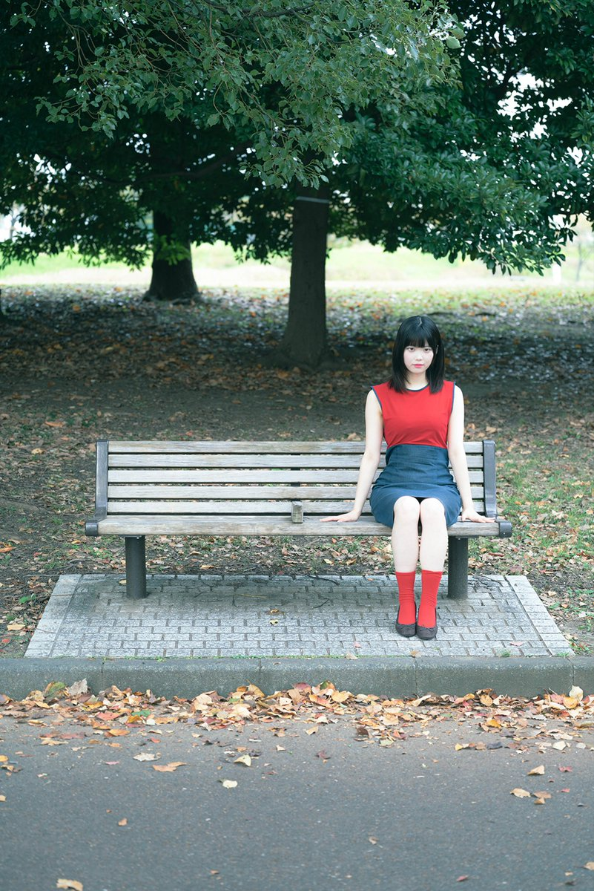

2026年12月6日（日）、東新宿PetitMOAで開催される「夢野くる レコ発ライブ」に、ちよじ（from セカンドワルツ）がソロで出演します！

今回はセカンドワルツとしてのバンド出演ではなく、ちよじのソロ出演です。

## 開催情報

| | |
| --- | --- |
| 公演名 | 夢野くる レコ発ライブ |
| 日程 | 2026年12月6日（日） |
| 会場 | 東新宿PetitMOA |
| 時間 | 開場 17:00 ／ 開演 17:30 |
| 料金 | 2,500円（別途ドリンク代） |

## 出演

- 夢野くる
- ちよじ（from セカンドワルツ）※ソロ出演
- 横沢俊一郎
- 他

## チケットについて

チケット等の詳細は、追ってお知らせします。

[公演の告知（X）](https://x.com/sakasama_info/status/2118659912418882015)
